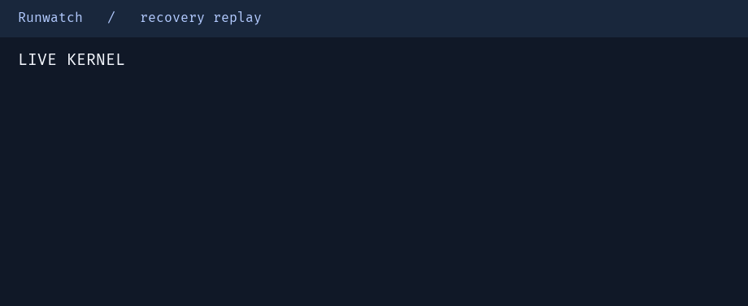

# When the last cell fails

The notebook prepares 1,000 rows, leaves them in memory, and fails on its final calculation. The preparation cell also appends to a file. Counting its entries reveals whether earlier work actually ran again.



| What happened | Recovery | Preparation executions at completion | Final sum |
| --- | --- | ---: | ---: |
| The last cell referenced an undefined variable | Edit the run-owned source and resume the live kernel | 1 | 499500 |
| The disposable kernel exited in the last cell | Edit the run-owned source and restart from cell zero | 2 | 499500 |

## Run both cases

From the repository root, with Python and uv installed:

```sh
uv run --extra supervisor python examples/recovery/replay.py
```

The driver copies the [notebook](example.ipynb) to a temporary directory for each case, binds the dashboard to localhost, edits only the run-owned source, and checks the actual counter and final notebook output. The deliberate kernel exit happens only in the second disposable run. The animation replays the output of this driver at reading speed.

[How Runwatch decides between resume and restart](../../README.md#failure-and-recovery)
